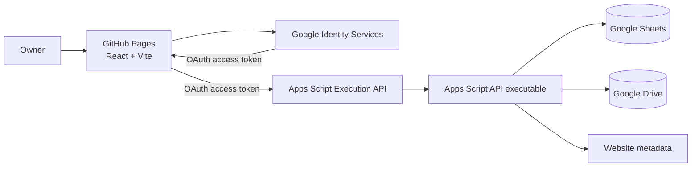

# All Bookmarks Architecture

## Overview

All Bookmarks is a static React/Vite application hosted on GitHub Pages. Google Apps Script is its trusted service layer: it authorizes requests, manages the Google Spreadsheet, fetches website metadata, and stores optional photos in Google Drive.

## Frontend

- `src/App.tsx` contains the library, Settings, authentication state, bookmark editor, and theme state.
- `src/lib/bridge.ts` calls the Google Apps Script Execution API using the signed-in owner’s OAuth access token. This is supported from GitHub Pages and avoids Apps Script iframe sandbox restrictions.
- `src/lib/image.ts` resizes and compresses image uploads before transfer.
- `src/styles.css` provides the responsive layout and both color themes. The active theme is set on `html[data-theme]`.

## Apps Script service

- `apps-script/Code.gs` validates Google access tokens with Google tokeninfo, checks the allowed-email list, migrates missing headers, and dispatches operations. Its public `api` function is invoked through the Apps Script Execution API.
- Supported operations include the standard bookmark/category operations plus `trashBookmark`, `restoreBookmark`, `permanentlyDelete`, `toggleCuration`, `bulkUpdate`, `findDuplicates`, and `mergeBookmarks`.

## Storage model

The first `bootstrap` creates the `Categories` sheet when needed. It holds `id`, `name`, `sheetName`, `sortOrder`, and `active` columns. Creating a category creates a matching bookmark sheet.

Each category sheet uses a consistent header row: bookmark identity and category, title/description/tags, main URL and five additional URLs, favicon/Open Graph URLs, metadata JSON, optional Drive photo URL, timestamps, owner email, favorite flag, notes, archive time, and recoverable-delete fields. Missing columns are appended without moving existing data. A legacy pin column is retained only to preserve existing sheet layouts and is no longer used.

Photos are saved in the Drive folder named by the `DRIVE_FOLDER_ID` Script Property. The generated file is shared as viewable-by-link so that the static site can render it.

## Configuration and deployment

The frontend requires `VITE_GOOGLE_CLIENT_ID` and `VITE_APPS_SCRIPT_ID` in `.env`. `VITE_APPS_SCRIPT_ID` is the Script ID shown in Apps Script Project Settings, not a web-app deployment URL. Apps Script requires these Script Properties:

- `SHEET_ID`
- `DRIVE_FOLDER_ID`
- `GOOGLE_OAUTH_CLIENT_ID`
- `ALLOWED_EMAILS`

Associate the Apps Script project with the OAuth client’s Google Cloud project, enable the Google Apps Script API, and deploy it as an API Executable. Run `npm run build` to populate `docs/` for GitHub Pages.
