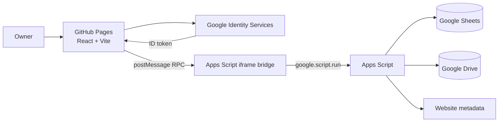

# Violet Bookmarks Architecture

## Overview

Violet Bookmarks is a static React/Vite application hosted on GitHub Pages. Google Apps Script is its trusted service layer: it authorizes requests, manages the Google Spreadsheet, fetches website metadata, and stores optional photos in Google Drive.

## Frontend

- `src/App.tsx` contains the library, Settings, authentication state, bookmark editor, and theme state.
- `src/lib/bridge.ts` loads the Apps Script web app into a hidden iframe and transports typed request/response messages with request IDs and timeouts. This avoids browser CORS restrictions between GitHub Pages and Apps Script.
- `src/lib/image.ts` resizes and compresses image uploads before transfer.
- `src/styles.css` provides the responsive layout and both color themes. The active theme is set on `html[data-theme]`.

## Apps Script service

- `apps-script/Bridge.html` receives parent-window RPC messages, invokes `google.script.run.api`, and posts results back to the frontend.
- `apps-script/Code.gs` validates Google ID tokens with Google tokeninfo, checks the allowed-email list, and dispatches operations.
- Supported operations: `bootstrap`, `listBookmarks`, `getBookmark`, `saveBookmark`, `deleteBookmark`, `moveBookmark`, `listCategories`, `saveCategory`, `deleteCategory`, `fetchMetadata`, and `uploadPhoto`.

## Storage model

The first `bootstrap` creates the `Categories` sheet when needed. It holds `id`, `name`, `sheetName`, `sortOrder`, and `active` columns. Creating a category creates a matching bookmark sheet.

Each category sheet uses a consistent header row: bookmark identity and category, title/description/tags, main URL and five additional URLs, favicon/Open Graph URLs, metadata JSON, optional Drive photo URL, timestamps, and owner email.

Photos are saved in the Drive folder named by the `DRIVE_FOLDER_ID` Script Property. The generated file is shared as viewable-by-link so that the static site can render it.

## Configuration and deployment

The frontend requires `VITE_GOOGLE_CLIENT_ID` and `VITE_APPS_SCRIPT_URL` in `.env`. Apps Script requires these Script Properties:

- `SPREADSHEET_ID`
- `DRIVE_FOLDER_ID`
- `GOOGLE_CLIENT_ID`
- `ALLOWED_EMAILS`
- `APP_ORIGIN` (reserved for deployment policy)

Deploy Apps Script as a web app running as the owner, then copy its `/exec` URL to the frontend environment file. Run `npm run build` to populate `docs/` for GitHub Pages.
